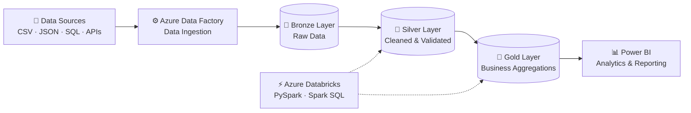

# 👋 Hi, I'm Diptarup Das

<h3 align="center">Azure Data Engineer | PySpark | Databricks | Azure Data Factory</h3>

  

  
  
  

---

## 🚀 About Me

I'm an **Azure Data Engineer with 5 years of professional experience**, passionate about building scalable, reliable and efficient data engineering solutions.

My experience revolves around developing data pipelines, implementing ETL/ELT workflows, transforming large datasets and optimizing cloud-based data platforms using Microsoft Azure technologies.

- 💼 Working at **Tata Consultancy Services (TCS)**
- ☁️ Specialized in Azure Data Engineering.
- ⚡ Hands-on experience with Azure Data Factory, Databricks and PySpark.
- 🐍 Strong working knowledge of Python and SQL.
- 🏗️ Experience with Medallion Architecture and Delta Lake.
- 🔄 Exploring workflow orchestration with Apache Airflow.
- 🎯 Interested in building scalable, production-ready data platforms.

**My engineering philosophy:** Build reliable pipelines, write optimized code, automate repetitive processes and make data useful for business decisions.

---

## 🧠 Technical Expertise

### ☁️ Cloud & Data Platforms

### 🐍 Programming & Big Data

### 🔄 Data Engineering & Orchestration

### 🛠️ Tools & Other Technologies

---

## 🏗️ Data Engineering Architecture

My preferred approach to building modern data pipelines follows the Medallion Architecture.

**Key engineering concepts:**

- Incremental data loading and watermark-based processing.
- Data cleansing, validation and transformation.
- Slowly Changing Dimensions (SCD Type 1 and Type 2).
- Delta Lake and ACID transactions.
- Spark performance optimization.
- Data orchestration and workflow monitoring.
- Data governance using Unity Catalog.

---

## 🚀 Featured Projects

### 1. Azure End-to-End Data Engineering

**Technology:** Azure Data Factory | Azure Databricks | ADLS Gen2 | PySpark | Delta Lake | SQL

Building an end-to-end data engineering workflow involving:

- Dynamic ingestion pipelines using Azure Data Factory.
- Incremental loading and watermark implementation.
- Bronze, Silver and Gold data processing.
- Data transformations using PySpark.
- Delta Lake storage and optimization.
- SCD Type 2 implementation.
- Star schema data modeling.
- Databricks Workflows and Unity Catalog.

### 2. Apache Airflow – Workflow Orchestration

**Repository:** [Apache_Airflow](https://github.com/diptarupdasgit/Apache_Airflow)

**Technology:** Python | Apache Airflow | Docker

Hands-on implementation and learning repository covering:

- DAG fundamentals and scheduling.
- TaskFlow API.
- Operators and task dependencies.
- XCom communication.
- Branching and conditional workflows.
- Parallel task execution.
- Airflow Assets.
- Workflow orchestration.

### 3. Walmart Data Engineering – dbt & Databricks

**Technology:** dbt | Databricks | SQL | Python

Practical data transformation project exploring:

- dbt project structure and models.
- SQL-based transformations.
- Data testing and validation.
- Databricks integration.
- Modular and reusable transformation logic.

---

## 📜 Certifications & Learning

- 🏅 Microsoft Azure Fundamentals – AZ-900
- 📚 Azure Data Engineering
- ⚡ Apache Spark & PySpark
- 🔄 Apache Airflow
- 🏗️ dbt & Modern Data Transformation

---

## 📊 GitHub Statistics

  
  

  

---

## 🎯 My Career Focus

I am focused on growing as an Azure Data Engineer, working on scalable cloud data platforms, advanced PySpark transformations, data pipeline optimization and modern data orchestration.

**Interested in:** Azure Data Engineer | Databricks Engineer | Big Data Engineer opportunities.

---

## 🤝 Let's Connect

  
  

  <i>Building. Learning. Optimizing. Engineering Data at Scale.</i>

  

