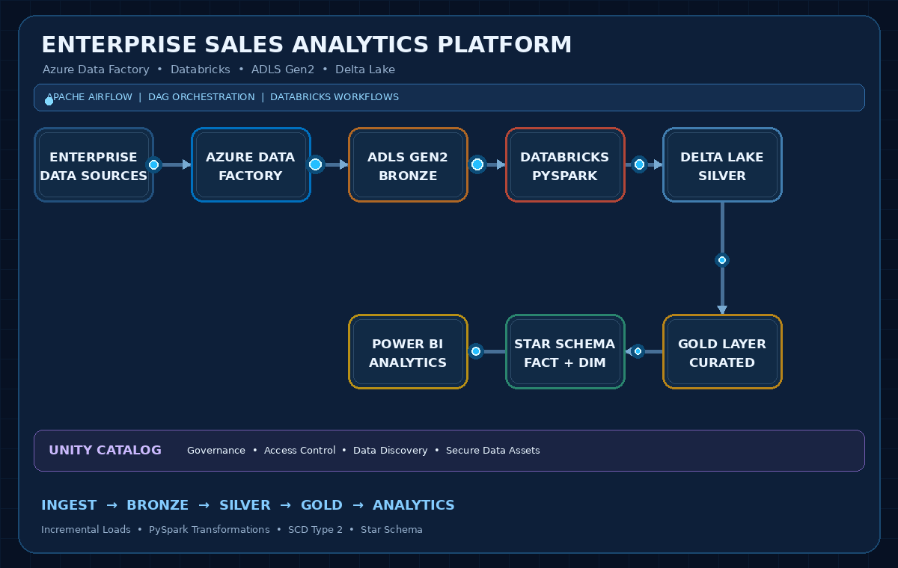
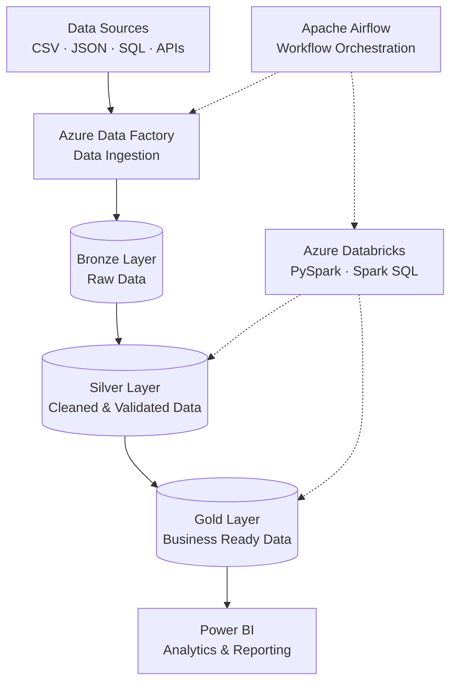

# 👋 Hi, I'm Diptarup Das

<h3 align="center">Azure Data Engineer | PySpark | Databricks | Azure Data Factory</h3>

  

  
  

---

## 🚀 About Me

I'm an **Azure Data Engineer with 5.2 years of professional experience**, currently working at **Tata Consultancy Services (TCS)**.

I specialize in building scalable data pipelines, developing ETL/ELT solutions, optimizing distributed data processing and implementing modern cloud-based data engineering architectures.

My professional experience includes enterprise data engineering initiatives involving Azure Data Factory, Azure Databricks, PySpark, ADLS Gen2, Delta Lake and Apache Airflow.

- 💼 Professional Experience: Tata Consultancy Services (TCS)
- ☁️ Cloud Platform: Microsoft Azure
- ⚡ Big Data: Apache Spark, PySpark, Databricks
- 🔄 Data Integration: Azure Data Factory, Apache Airflow
- 🏗️ Architecture: Medallion Architecture, Delta Lake
- 🗄️ Data Modeling: Star Schema, SCD Type 2
- 🔐 Governance: Unity Catalog
- 🎯 Focus: Scalable, optimized and reliable data platforms

---

## 🧠 Technical Expertise

### ☁️ Cloud & Data Platforms

### 🐍 Programming & Big Data

### 🔄 Data Engineering & Orchestration

### 🛠️ Development & Tools

---

# 💼 Professional Experience – TCS

## 1. Enterprise Sales Analytics Platform

**Environment:** Azure Cloud

**Technology Stack:** Azure Data Factory | Azure Databricks | ADLS Gen2 | Delta Lake | Apache Airflow | Unity Catalog | Power BI

Designed and implemented enterprise-scale data engineering workflows to support sales analytics and business reporting.

### Key Contributions

- Designed end-to-end Big Data Architecture using Azure Data Factory, Azure Databricks, ADLS Gen2 and Delta Lake, following Medallion Architecture (Bronze, Silver and Gold).
- Developed metadata-driven ADF pipelines with dynamic parameterization to support reusable and scalable data ingestion.
- Orchestrated data workflows using Apache Airflow DAGs and Databricks Workflows integrated with Azure Data Factory.
- Built PySpark notebooks for data cleansing, transformation, aggregation and implementation of business logic.
- Implemented watermark-based incremental loading to process newly added or modified records.
- Implemented Slowly Changing Dimension Type 2 (SCD Type 2) to maintain historical data changes.
- Designed Star Schema with Fact and Dimension tables using surrogate keys for analytical reporting.
- Delivered curated datasets to Power BI and managed data governance and access security through Unity Catalog.

## Enterprise Sales Analytics Architecture

## 2. SAS to Python Migration – Enterprise Cost Optimization

**Environment:** Azure Cloud | Azure Databricks

**Technology Stack:** Python | PySpark | Apache Airflow | Azure Databricks

Led the migration of legacy SAS analytics workloads to a modern Python/PySpark-based data processing platform on Azure Databricks, supporting enterprise cost optimization and modernization.

### Key Contributions

- Led end-to-end migration of the organization's legacy SAS analytics platform to a Python/PySpark stack on Azure Databricks, orchestrated using Apache Airflow.
- Rewrote and validated 100+ SAS programs into PySpark equivalents within approximately 3 months, covering batch scheduling and statistical processing logic.
- Developed a parallel-run data validation framework to compare SAS and Python outputs row by row, ensuring zero regression before production cutover.
- Supported modernization of legacy analytical workloads and retirement of SAS licensing and associated infrastructure.

### Business Impact

- 💰 Achieved estimated annual cost savings of **$150K–$500K** through SAS licensing and infrastructure cost elimination upon full decommissioning.
- ⚡ Modernized legacy analytics workloads using Python and PySpark.
- ✅ Improved migration reliability through parallel execution and data reconciliation.

---

# 🧪 Personal Hands-on Projects

These repositories showcase my independent learning, technical experimentation and practical implementation of modern data engineering concepts.

## 1. Apache Airflow – Workflow Orchestration

**Repository:** [Apache_Airflow](https://github.com/diptarup669/Apache_Airflow)

**Technology:** Python | Apache Airflow | Docker

Hands-on implementation and exploration of workflow orchestration concepts.

### Topics Covered

- DAG fundamentals and scheduling.
- TaskFlow API.
- Operators and task dependencies.
- XCom communication.
- Branching and conditional workflows.
- Parallel task execution.
- Airflow Assets.
- Workflow orchestration.

## 2. Walmart Data Engineering – dbt & Databricks

**Technology:** dbt | Databricks | SQL | Python

Personal implementation focused on modern data transformation and analytics engineering.

### Topics Covered

- dbt project structure and models.
- SQL-based transformations.
- Data testing and validation.
- Databricks integration.
- Modular and reusable transformation logic.

---

## 🏗️ Modern Data Engineering Architecture

My preferred approach to building modern data platforms follows the Medallion Architecture.

### Core Engineering Concepts

- Incremental data loading and watermark processing.
- Data cleansing, validation and transformation.
- Slowly Changing Dimensions (SCD Type 1 and Type 2).
- Delta Lake and ACID transactions.
- Spark performance optimization.
- Workflow orchestration and monitoring.
- Data governance using Unity Catalog.

---

## 📜 Certifications

- 🏅 Microsoft Azure Fundamentals – AZ-900

---

## 📊 GitHub Statistics

  
  

  

---

## 🎯 Career Focus

Continuously building expertise in Azure Data Engineering, distributed data processing, modern data architecture and cloud-based analytics platforms.

**Interested in opportunities:**

- Azure Data Engineer
- Databricks Engineer
- Big Data Engineer

---

## 🤝 Let's Connect

  
  

  <i>Building. Learning. Optimizing. Engineering Data at Scale.</i>

  

